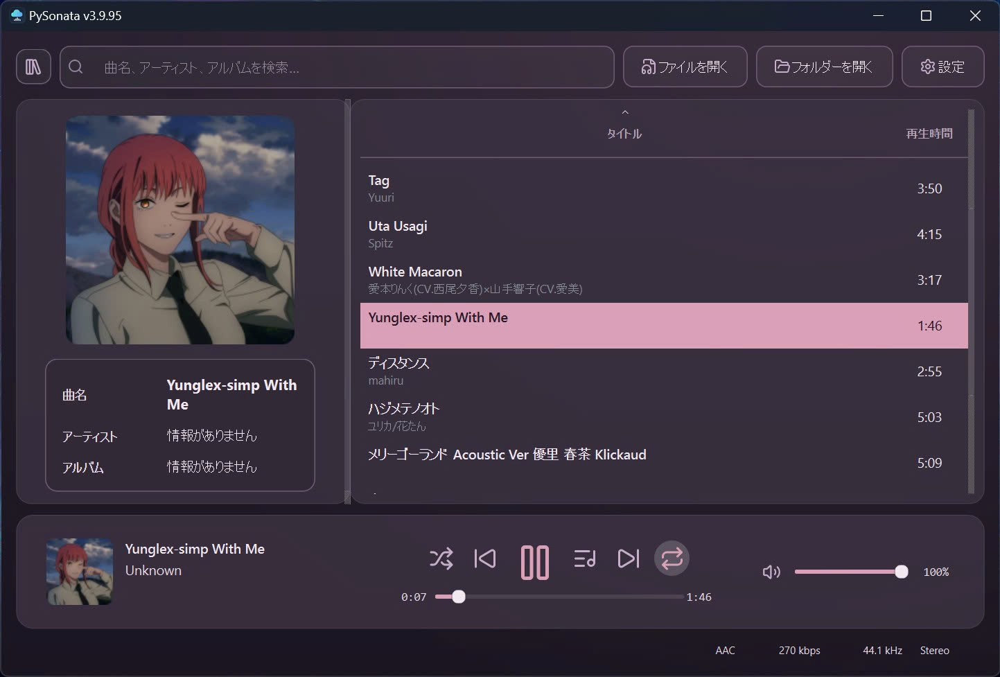

# PySonata

**Advanced music features. Simplified interface.**

A friendly, easy-to-use Windows music app that brings powerful music tools into a clean, approachable experience.

---

## One clear view of your music

  

## Powerful features, made approachable

PySonata combines advanced music capabilities with a simplified, user-friendly interface.

- **Music library & playback** — browse your collection and access playback controls.
- **Lyrics** — view lyrics alongside your music.
- **Metadata & cover art** — manage track information and artwork.
- **Audio conversion** — convert audio and handle batch workflows.
- **Personalization** — choose from available themes and language options.
- **Online media workflows** — use supported online extraction, download and playback features.

## Download PySonata 3.9.95

**[⬇ Download for Windows x64 (ZIP)](https://github.com/levietngoc3275-commits/PySonata/releases/download/v3.9.95/PySonata-v3.9.95-Windows-x64.zip)**

Extract the ZIP and run `PySonata.exe`.

[View release notes and additional downloads](https://github.com/levietngoc3275-commits/PySonata/releases/tag/v3.9.95) · [Proprietary license / EULA](LICENSE.md)

---

PySonata · Advanced music features, simplified.

