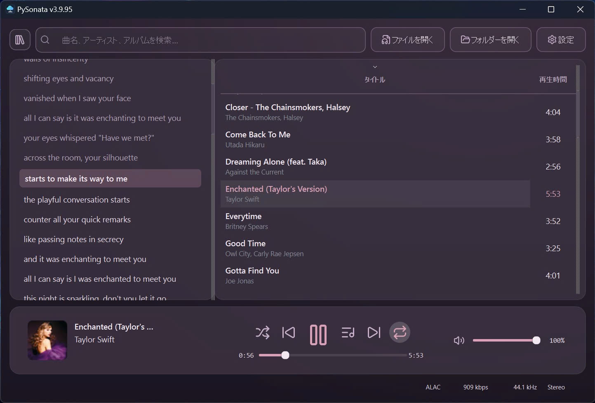

# PySonata

**A focused music experience for Windows.**

A compact desktop music player built around a clear library view, persistent playback controls, and a dedicated lyrics workspace.

---

## Screenshots

### Music library

  

### Lyrics workspace

  

## Highlights

| Feature | Overview |
|---|---|
| **Music library** | Search and browse a music collection in a compact, readable desktop layout. |
| **Playback** | Persistent transport controls, progress seeking, volume, shuffle and repeat. |
| **Lyrics workspace** | Keep lyrics visible alongside the current track and library. |
| **Metadata & artwork** | View and manage track metadata and embedded cover art. |
| **Audio conversion** | Convert common audio formats, including batch-oriented workflows. |
| **Themes & languages** | Multiple visual themes and a multilingual interface. |
| **Online media workflows** | Online extraction, download and playback features. |

## About PySonata

PySonata brings everyday listening and music-library tasks together in a Windows desktop application. Its interface emphasizes readable track lists, visible playback controls, and a dedicated space for lyrics.

- **Showcase version:** 3.9.95
- **Platform:** Windows x64
- **Software type:** Proprietary desktop application

## Source and distribution

This repository is a **project showcase** containing an overview and selected interface screenshots. It does not distribute PySonata's application source code, build scripts, executable files, or installers.

PySonata is proprietary software. This showcase does not grant permission to copy, modify, or redistribute the application.

---

PySonata · Windows music player and library

